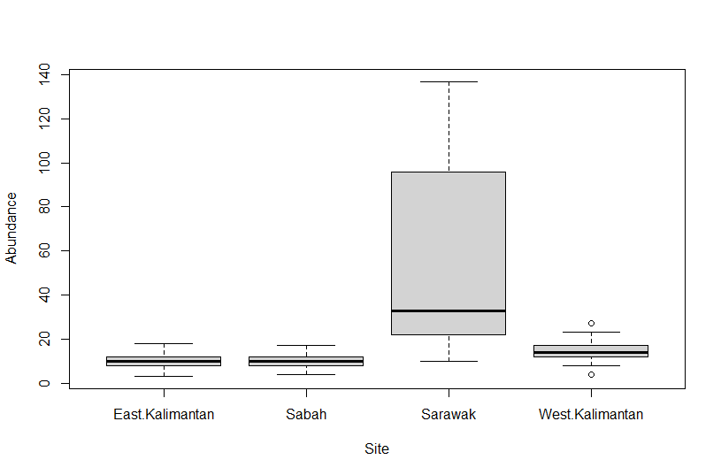
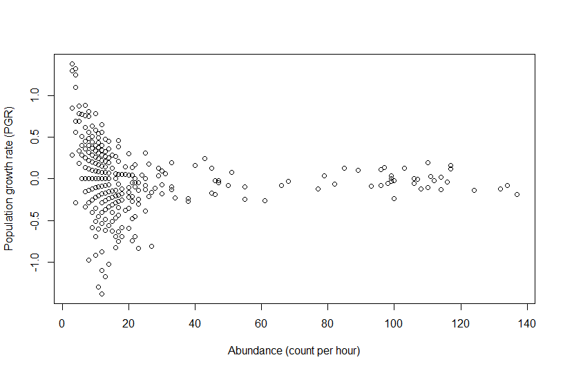

# Butterfly Population Analysis in Borneo

## Overview

An R-based analysis completed during my university biology degree, investigating butterfly abundance, population growth and estimated carrying capacity at four monitoring sites in Borneo: Sabah, Sarawak, West Kalimantan and East Kalimantan.

This repository presents my original coursework analysis, with only the data-import lines adapted so that the script can read the accompanying CSV files.

## Tools and Methods

- **R (base R)** for data import, manipulation, statistical modelling and plotting
- **Poisson generalised linear model (GLM)** to compare butterfly abundance across sites
- **Linear regression** to examine population growth rate (PGR) in relation to abundance and site
- **Separate site-specific linear regressions** to calculate exploratory carrying-capacity estimates

## Data

The analysis uses two supplied datasets:

- [`butterfly_counts.csv`](butterfly_counts.csv) — weekly abundance counts from four sites (104 weeks)
- [`butterfly_dynamics.csv`](butterfly_dynamics.csv) — abundance and PGR records for four sites (103 weeks)

The data came from the original university coursework. Reuse and redistribution are subject to the data owner's permissions.

## Visualisations

### Butterfly abundance by site

The boxplot compares butterfly abundance across the four monitoring sites.

### Population growth rate and abundance

The scatterplot illustrates the relationship between abundance and population growth rate.

## How to Run

1. Install R, and optionally RStudio.
2. Download the repository files into one folder.
3. Open `butterfly_analysis.R` in RStudio.
4. Set the working directory to that folder (in RStudio: **Session → Set Working Directory → To Source File Location**).
5. Run or source the script. It produces plots and model summaries in R; it does **not** automatically export results to files.

No extra R packages are required.

## Interpretation and Limitations

- The original Poisson abundance model showed substantial overdispersion (deviance divided by residual degrees of freedom approximately 7.42). This affects the reliability of the model's standard errors and significance tests.
- Carrying-capacity calculations are exploratory estimates derived from fitted straight lines, not direct population measurements.
- The original written report lists Sarawak's estimated carrying capacity as **+1.81**, whereas its stated calculation on the supplied data yields approximately **−1.81**. The negative estimate should not be interpreted as a biologically meaningful carrying capacity.
- The dataset covers observations at four sites; results should not be assumed to generalise to all butterfly populations.

## Original Report

The full university report is included: [Variation in Abundance and Resilience of Butterflies in Borneo](borneo_butterfly_analysis_report.pdf).

## Code Provenance

`butterfly_analysis.R` follows the R code in the appendix of my original report. The two dataset-assignment lines were replaced with `read.csv()` calls to make the script runnable from this repository; line wrapping and spacing have been tidied, but the original statistical methods and calculations have been retained.
